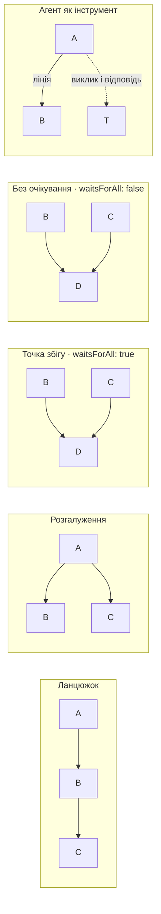
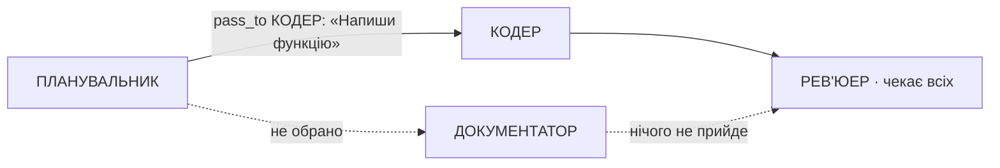

# Coder — пам'ятка для агентів: як користуватися платформою

Coder — десктопна платформа, де роботу виконує граф LLM-агентів: відповідь одного йде наступному по намальованій лінії, а кожен агент має свою модель, промпт, пам'ять і інструменти. Усе налаштування проєкту — файли в одній теці; ключі та токени — у застосунку.

## Поняття

| Поняття         | Значення                                                                                 |
| --------------- | ---------------------------------------------------------------------------------------- |
| Проєкт          | тека з `project.yaml` і файлами частин                                                   |
| Агент           | модель + промпт + пам'ять + числа + видані інструменти                                   |
| Модель          | модель провайдера з цінами та двома стелями                                              |
| Провайдер       | сервіс, що обслуговує модель (список — у розділі «Провайдери»)                           |
| Промпт          | системний промпт агента; один промпт можуть мати кілька агентів                          |
| Лінія           | зв'язок «від → до»: відповідь першого агента стає входом другого                         |
| Видача          | дозвіл агенту викликати команду, функцію MCP-сервера, іншого агента або системну команду |
| Розмова         | чат із агентом — послідовність питань                                                    |
| Питання         | повідомлення (з вкладеннями), що запускає прохід                                         |
| Прохід          | пробіг графом від агента, якому написали, до агентів без вихідних ліній                  |
| Хід             | робота одного агента: раунди моделі й виклики інструментів до відповіді                  |
| Крок            | запис одного ходу в історії: відповідь, кінець, токени, гроші, виклики                   |
| Пам'ять         | що агент бачить перед входом: «Своя», «Загальна» або «Вимкнено»                          |
| Композер        | автоматичне стиснення пам'яті моделлю агента, коли вона досягла порогу                   |
| Стеля контексту | скільки **символів** можна надіслати моделі                                              |
| Стеля відповіді | скільки **токенів** модель може сказати за один раунд                                    |

## Що можна створити

- **Агентів** будь-якої кількості, кожного на своїй моделі й зі своїм промптом.
- **Граф** з ліній: ланцюжки, розгалуження, точки збігу (з очікуванням або без), незалежні острови.
- **Команди**: будь-який рядок терміналу з типізованими параметрами, який агент запускає в теці проєкту.
- **MCP-сервери**: локальні (процес) або віддалені (HTTP), з токеном або без; агенту видаються окремі функції.
- **Агентів як інструменти**: один агент викликає іншого запитом і отримує його відповідь; вкладення дозволене.
- **Системні команди** (`pass_to`, `finish_here`): інструменти самого застосунку; `pass_to` несе текст, який агент сам пише для названих наступників.
- **Пам'ять** для кожного агента: власна нитка, спільна історія питання або без пам'яті; довга пам'ять стискається автоматично.
- **Вкладення** до питання: файли й теки цілком (у вікні).
- **Запуски** з вікна або командного рядка; кілька розмов паралельно.
- **Історію** прогонів з вартістю кожного кроку, пошуком і повтором кроку, що перервався.

## Порядок налаштування

1. **Тека проєкту**: створити проєкт у застосунку або покласти `project.yaml` із `version: 1`, `name` і порожніми `models`, `prompts`, `commands`, `servers`, `agents`, `links`.
2. **Провайдер**: у застосунку ввести ключ або адресу (див. «Провайдери»).
3. **Модель**: `models/<id>.yaml` + запис із `provider` у `project.yaml`.
4. **Промпт**: `prompts/<id>.md` + запис із `name`.
5. **Агент**: `agents/<id>.yaml` + запис із `modelId`, `promptId`, `tools`.
6. **Інструменти** (за потреби): `commands/<id>.yaml`, `servers/<id>.yaml` (токен — у застосунку), видачі в `tools` агента. Локальний сервер, записаний у файл руками, ще треба погодити на цій машині (див. «Інструменти»).
7. **Лінії**: записи в `links`.
8. **Запуск**: питання першому агенту у вікні або `npm run agent`.
9. **Перевірка**: слово-кінець кожного кроку або код виходу команди; при проблемі — «Типові проблеми».

## Файли проєкту

`project.yaml` тримає зв'язки, кожна частина — свої властивості у файлі `<каталог>/<id>`. Усі id — UUID, унікальні в межах проєкту.

```text
проєкт/
  project.yaml
  agents/<id>.yaml
  models/<id>.yaml
  prompts/<id>.md
  commands/<id>.yaml
  servers/<id>.yaml
```

```yaml
# project.yaml (id скорочені)
version: 1
name: мій-проєкт
models:
  - { id: m-1, file: models/m-1.yaml, provider: anthropic }
prompts:
  - { id: p-1, name: Рев'юер, file: prompts/p-1.md }
commands:
  - { id: c-1, file: commands/c-1.yaml }
servers:
  - { id: s-1, file: servers/s-1.yaml }
agents:
  - id: a-1
    file: agents/a-1.yaml
    modelId: m-1
    promptId: p-1
    tools:
      - { id: g-1, source: command, commandId: c-1, pinned: [] }
      - { id: g-2, source: mcp, serverId: s-1, functionName: search_issues }
      - { id: g-3, source: agent, agentId: a-2 }
      - { id: g-4, source: system, command: pass_to }
  - { id: a-2, file: agents/a-2.yaml, modelId: m-1, promptId: p-1, tools: [] }
links:
  - { id: l-1, from: a-1, to: a-2 }
```

- Незаписане число — `null`; застосунок покаже «НЕ ЗАПОВНЕНО» з назвою поля, і агент не ходитиме, доки поле не заповнене.
- Відкритий застосунок підхоплює зміни файлів сам.
- Ключі й токени у файлах не зберігаються, тож теку можна комітити цілком.

## Довідник параметрів

**Агент** — `agents/<id>.yaml`; зв'язки `modelId`, `promptId`, `tools` — у `project.yaml`.

| Поле          | Значення                  | Що робить                                                                                                      |
| ------------- | ------------------------- | -------------------------------------------------------------------------------------------------------------- |
| `name`        | текст                     | ім'я агента; якщо агента видано інструментом, це назва функції (латиницею, без пробілів)                       |
| `purpose`     | текст або `null`          | опис функції для моделі, яка викликає цього агента як інструмент                                               |
| `color`       | `"#rrggbb"`               | колір на полотні                                                                                               |
| `x`, `y`      | числа                     | місце на полотні                                                                                               |
| `isActive`    | `true` / `false`          | вимкнений агент не ходить; лінія до нього зупиняє прохід                                                       |
| `waitsForAll` | `true` / `false`          | `true` — у точці збігу чекає всіх постачальників і ходить один раз; `false` — ходить на кожну відповідь окремо |
| `memory`      | `own` / `shared` / `none` | режим пам'яті (див. «Пам'ять і стиснення»)                                                                     |
| `compressAt`  | ціле 70–90, типово 90     | поріг стиснення, % стелі контексту; для `none` не потрібен                                                     |
| `compressTo`  | ціле 10–30, типово 10     | ціль стиснення, % стелі; для `none` не потрібна                                                                |
| `maxCalls`    | ціле ≥ 0; 0 = без межі    | скільки раундів моделі та запусків інструментів разом може бути в одному ході                                  |
| `temperature` | 0–1                       | температура моделі; 0 означає «не надсилати» — діє значення провайдера                                         |
| `modelId`     | id моделі                 | на чому працює агент                                                                                           |
| `promptId`    | id промпту або `null`     | системний промпт агента                                                                                        |
| `tools`       | список видач              | що агенту дозволено викликати                                                                                  |

**Модель** — `models/<id>.yaml`; `provider` — у `project.yaml`.

| Поле             | Значення                                                                                                   | Що робить                                                              |
| ---------------- | ---------------------------------------------------------------------------------------------------------- | ---------------------------------------------------------------------- |
| `title`          | текст                                                                                                      | ім'я моделі так, як її називає провайдер (`claude-sonnet-4-5`)         |
| `inputPrice`     | число ≥ 0                                                                                                  | ціна за 1 000 000 вхідних токенів                                      |
| `outputPrice`    | число ≥ 0                                                                                                  | ціна за 1 000 000 вихідних токенів                                     |
| `contextCeiling` | 1–1 048 576, **символи**                                                                                   | скільки можна надіслати за хід; від неї рахуються поріг і ціль пам'яті |
| `answerCeiling`  | 1 024–524 288, **токени**                                                                                  | скільки модель може сказати за один раунд                              |
| `provider`       | `anthropic`, `openai`, `openrouter`, `google`, `opencode`, `runpod`, `runpod-openai`, `ollama`, `lmstudio` | хто обслуговує модель                                                  |

Ціни й стелі можуть стояти `null`, але агент на такій моделі не ходить (`notFilled`).

**Промпт** — `prompts/<id>.md` (текст як є) + `name` у `project.yaml`.

**Команда** — `commands/<id>.yaml`.

| Поле                       | Значення                            | Що робить                                                                                       |
| -------------------------- | ----------------------------------- | ----------------------------------------------------------------------------------------------- |
| `name`                     | латиниця, цифри, `_`; ≤ 64          | назва функції для моделі (`run_tests`), унікальна в проєкті                                     |
| `description`              | текст                               | опис функції для моделі                                                                         |
| `run`                      | рядок терміналу                     | `{ім'я}` замінюється значенням параметра без лапок і екранування; незаповнений параметр випадає |
| `parameters[].id`          | UUID                                | на нього посилається `pinned`                                                                   |
| `parameters[].name`        | текст                               | ім'я параметра, те саме, що в `{…}`                                                             |
| `parameters[].type`        | `text` / `number` / `bool` / `enum` | тип, проти якого перевіряється аргумент моделі                                                  |
| `parameters[].values`      | список                              | допустимі значення для `enum`                                                                   |
| `parameters[].isRequired`  | `true` / `false`                    | чи модель мусить його передати                                                                  |
| `parameters[].description` | текст                               | опис параметра для моделі                                                                       |

**MCP-сервер** — `servers/<id>.yaml`.

| Поле      | Значення         | Що робить                                                                     |
| --------- | ---------------- | ----------------------------------------------------------------------------- |
| `name`    | текст            | назва сервера, унікальна в проєкті                                            |
| `isLocal` | `true` / `false` | `true` — запускається процесом за `run`; `false` — підключається за `address` |
| `run`     | рядок            | команда запуску локального сервера (без шела: конвеєри й `&&` не працюють)    |
| `address` | URL              | адреса віддаленого сервера (streamable HTTP)                                  |
| `signIn`  | `none` / `token` | `token` — сервер потребує токен, введений у застосунку                        |
| `env`     | список імен      | змінні середовища локального сервера; значення вводяться в застосунку         |

**Видача** — елемент `tools` агента у `project.yaml`.

| `source`  | Поля                                                | Що дає                                                                                         |
| --------- | --------------------------------------------------- | ---------------------------------------------------------------------------------------------- |
| `command` | `commandId`, `pinned: [{ id, parameterId, value }]` | команду; `pinned` фіксує значення параметра для цього агента, модель цього параметра не бачить |
| `mcp`     | `serverId`, `functionName`                          | одну функцію сервера, названу як у самого сервера                                              |
| `agent`   | `agentId`                                           | іншого агента як функцію з одним параметром `request`                                          |
| `system`  | `command`: `pass_to` / `finish_here`                | системну команду (див. «Системні команди»)                                                     |

**Лінія** — елемент `links`: `{ id, from, to }`, де `from` і `to` — id агентів.

## Пам'ять і стиснення

Модель агента за хід отримує: системний промпт, потім пам'ять, потім новий вхід.

| `memory`              | У ході по графу                                                                          | Як інструмент                              | Для чого                                |
| --------------------- | ---------------------------------------------------------------------------------------- | ------------------------------------------ | --------------------------------------- |
| `own` («Своя»)        | свої пари «вхід → відповідь» у цій розмові                                               | свої виклики в межах одного ходу покликача | агент веде діалог                       |
| `shared` («Загальна») | питання людини з вкладеннями і всі відповіді цього питання з позначкою, хто кому передав | те саме                                    | агент зводить чи перевіряє роботу інших |
| `none` («Вимкнено»)   | лише свій вхід                                                                           | лише запит                                 | кожна задача самостійна                 |

- `own` обнуляється в новій розмові («+ НОВИЙ ЧАТ»). У пару потрапляє лише хід, що відповів; виклики інструментів у нитку не входять.
- `shared` читається на момент ходу: відповідей гілок, що ще працюють, там немає. Інші питання розмови, виклики інструментів і ходи, що впали, до неї не входять.

**Стиснення.** Перед кожним ходом рахується довжина в символах (промпт + вхід + пам'ять) проти `contextCeiling` C. Резерв пам'яті R = `compressTo` % від C.

| Умова                                                              | Результат                           |
| ------------------------------------------------------------------ | ----------------------------------- |
| усе разом < `compressAt` % від C                                   | хід йде як є                        |
| усе разом ≥ `compressAt` %, але промпт + вхід + R < `compressAt` % | пам'ять стискається до R, потім хід |
| промпт + вхід + R ≥ `compressAt` %                                 | хід не починається (`tooLong`)      |
| `memory: none` і все разом > C                                     | хід не починається (`tooLong`)      |

Приклад: C = 100 000, 90/10 → пам'ять стискається на 90 000 символів до 10 000, а промпт і вхід разом мають бути менше 80 000.

- Стискає модель самого агента одним окремим викликом; його вартість входить у крок.
- Стиснений текст зберігає факти, рішення, імена, числа, від найважливішого; дослівні формулювання можуть змінитися.
- У чаті над карткою з'являється рядок «ПАМ'ЯТЬ СТИСНУТО · поріг → ціль»; стиснення агентів-інструментів так не показуються.
- Агент-інструмент має ті самі правила; другий виклик того самого інструмента в одному ході не стискає вдруге.

## Граф

Прохід починається від агента, якому написали, і йде вихідними лініями до агентів без вихідних ліній. По лінії йде тільки текст відповіді (або текст, переданий через `pass_to`), без імені відправника. Агент не бачить графа; наступників і текст для них він обирає лише тоді, коли йому видано системну команду `pass_to`.



- **Ланцюжок**: відповідь проходу — відповідь C.
- **Розгалуження**: відповідь іде по всіх вихідних лініях одночасно, гілки працюють паралельно; відповідь проходу — B і C.
- **Точка збігу** (`waitsForAll: true`): D чекає всіх живих постачальників, яких досягає цей прохід, і працює один раз над їхніми відповідями — одним входом, у порядку приходу, через порожній рядок. Вимкнених постачальників і тих, до кого прохід не дійде, не чекає. З `false` D працює на кожну відповідь окремо, одразу.
- **Агент як інструмент**: T відповідає лише A, коли A його викличе (див. «Інструменти»); лінія A → B передає далі готову відповідь A.
- **Старт з середини**: питання будь-якому агенту запускає прохід від нього; агенти вище не ходять.
- **Вибір і цикли в роботі** («перевір і перероби») робляться агентами-інструментами: той, хто вирішує, кличе їх стільки разів, скільки дозволяє його `maxCalls`.
- Тупики і незалежні острови допустимі; окремого вузла «фініш» немає.

## Системні команди

Системна команда — інструмент самого застосунку. Її видають з панелі агента, у секції «СИСТЕМНІ», так само як команду чи агента; у файлі це видача `source: system` з іменем `command`. Застосунок нічого не вирішує за агента.

| Команда       | Параметри                                                                            | Що робить                                                    |
| ------------- | ------------------------------------------------------------------------------------ | ------------------------------------------------------------ |
| `pass_to`     | `to` — список імен його наступників (≥ 1); `text` — що вони отримають (обов'язковий) | передає `text` названим; решта наступників нічого не отримає |
| `finish_here` | —                                                                                    | завершує гілку: далі нічого не йде                           |

- `pass_to` **не завершує хід**: агент працює далі, може викликати інші інструменти й інші `pass_to` (різним наступникам — різний текст), а наприкінці пише відповідь. Якщо одного наступника названо кілька разів, його тексти склеюються в порядку викликів. Порожній `text` або чуже ім'я відхиляється з поясненням, і модель пробує ще раз.
- `finish_here` **завершує хід** одразу, без додаткового раунду моделі. Якщо в тому самому ході був `pass_to`, передане все одно доходить до названих, решта ліній — «не обрано».
- Команда діє, лише якщо з агента виходить жива лінія. Без ліній секція показує видану команду притемненою («Немає ліній, що виходять, — команда не діє»), а моделі функції не дають.
- Що піде далі, вирішує сам факт виклику, без жодного слова в промпті: якщо за хід `pass_to` викликали хоч раз, лініями йдуть **лише тексти з `pass_to`**, а відповідь агента лишається в його картці; якщо не викликали — відповідь агента йде всіма лініями. Хід з `pass_to` чи `finish_here` без фінальних слів закінчується `done`, а не `silent` («Модель не сказала нічого»).
- Агент бачить лише своїх наступників: їхні імена і `purpose`. Наступники з однаковим іменем отримують у списку номер: `КОДЕР`, `КОДЕР (2)`.
- Лінія, якою не передали, у розмові стоїть як «… НЕ ПЕРЕДАЄ ⇢ … · НЕ ОБРАНО», а після `finish_here` — «… · ГІЛКУ ЗАВЕРШЕНО». Агент по такій лінії не ходить.
- Те, що по лінії нічого не прийшло, іде далі вниз: агент, до якого дійшла відповідь іншою лінією, працює без очікування тих, хто не передав; агент, до якого не прийшло нічого, не ходить і сам передає це далі.
- Точка збігу з `waitsForAll: true` чекає лише тих постачальників, які ще можуть передати. Якщо дехто не передав, вхід закінчується рядком «Не передали нічого: 1 з 3 постачальників роботи.», тож модель знає, що отримала не все.
- На екрані виклик стоїть рядком у ході: «ПЕРЕДАНО → КОДЕР» або «ГІЛКУ ЗАВЕРШЕНО», без коду, часу й відповіді для копіювання; пігулка очікування показує «Чекає TESTER · Відповів 1 з 3 · Не передав 1».
- Вибір діє в межах проходу. Повтор після падіння не відправляє роботу по лінії, яку агент не обрав, а закриває її так само, як вперше.
- Падіння кроку лишається падінням: вибір такого кроку не діє, прохід чекає «СПИТАТИ ЩЕ РАЗ».
- Агент із видачею системної команди, якого викликано як інструмент, маршруту не отримує: його лінії не спрацьовують.
- Поле `choosesRoute` у файлі агента ігнорується й не записується назад; маршрут обирають `pass_to` і `finish_here`.



Тут РЕВ'ЮЕР не чекає ДОКУМЕНТАТОРА: працює на відповіді КОДЕРА, і вхід закінчується рядком про одного, хто не передав.

## Інструменти

| Вид         | Як виконується                                                                          | Перевірка аргументів                                                           | Що отримує модель                               |
| ----------- | --------------------------------------------------------------------------------------- | ------------------------------------------------------------------------------ | ----------------------------------------------- |
| Команда     | рядок `run` з підставленими аргументами запускається в теці проєкту                     | так: аргумент не того типу відхиляється з назвою поля, команда не запускається | вивід команди                                   |
| Функція MCP | виклик на сервері                                                                       | ні, це справа сервера                                                          | текст сервера; картинки й звук лише називаються |
| Агент       | цілий хід того агента з його моделлю, промптом, пам'яттю й інструментами                | один текстовий `request`                                                       | відповідь агента або причина невдачі            |
| Системна    | нічого не запускається: `pass_to` передає `text` названим, `finish_here` завершує гілку | `to` — лише імена наступників; `text` не порожній                              | «Передам: КОДЕР.» або «Гілку завершено.»        |

- Кожен виклик видно в чаті й записується в крок. Результат інструменту йде моделі як є; чи повторити виклик, вирішує сама модель.
- Закріплений аргумент команди (`pinned`) завжди перемагає аргумент моделі — так агента обмежують, наприклад, однією текою.
- Функції MCP-сервера запитуються в нього щоразу; сервер, що впав, наступного разу запускається заново.
- **Локальний сервер не стартує сам**: при відкритті проєкту жоден локальний сервер не запускається (віддалені опитуються). Перший запуск рядка `run` на цій машині потребує згоди: її дають у вікні застосунку («ЗАПУСТИТИ» → «Запустити») або зберігаючи сервер у формі (рядок, написаний у формі, вважається погодженим). Згода живе на машині, не в проєкті, і прив'язана до рядка дослівно: змінився `run` у файлі — треба погодити знову.
- Хід агента, якому видано функцію непогодженого локального сервера, не починається (`noConsent`): нічого не запущено й не витрачено. Командний рядок згоди не дає — її дають у вікні, потім повторюють питання.
- Піднятий локальний сервер у рядку списку MCP несе «ЗУПИНИТИ»: процес відпускається, рядок знову «ФУНКЦІЇ НЕВІДОМІ», згода лишається. Це не заборона: хід агента, якому видано функції сервера, піднімає його сам. Виклик, що йшов у мить зупинки, закінчується неуспіхом, як у сервера, що впав, і хід триває. Віддалений сервер «ЗУПИНИТИ» не має.
- Агент-інструмент мовчить у чаті, його лінії не спрацьовують, а вартість (разом із вкладеними викликами) входить у крок покликача. Якщо виклик не вдався (задовгий запит, падіння провайдера), покликач отримує причину текстом і продовжує свій хід.
- У промпті покликача варто прямо назвати інструмент і сказати, коли його викликати.

## Провайдери

| `provider`                      | Що ввести в застосунку    | Виклик функцій               |
| ------------------------------- | ------------------------- | ---------------------------- |
| `anthropic`                     | ключ                      | так                          |
| `openai`                        | ключ                      | так                          |
| `openrouter`                    | ключ                      | так                          |
| `google`                        | ключ                      | так                          |
| `opencode` (OpenCode Go)        | ключ                      | так                          |
| `runpod` (RunPod Queue)         | ключ і адреса endpoint    | ні                           |
| `runpod-openai` (RunPod OpenAI) | ключ і адреса endpoint    | так, якщо endpoint їх вмикає |
| `ollama`                        | адреса локального сервера | так                          |
| `lmstudio`                      | адреса локального сервера | так                          |

- Ключі, адреси й токени MCP зберігаються на машині та діють для всіх проєктів, і для вікна, і для командного рядка.
- Агент з будь-якою видачею, системною теж, на провайдері без виклику функцій не ходить (`noTools`).
- Провайдера можна вимкнути в його картці («ВИМКНУТИ») і ввімкнути назад («УВІМКНУТИ»). Вимкнення діє лише на цій машині й у `project.yaml` не потрапляє; ключ і адреса лишаються. До вимкненого нічого не надсилається, локальний не опитується, а агент на його моделі не ходить (`providerOff`) — ця причина стоїть перед усіма іншими, `noTools` теж. Командний рядок читає ті самі налаштування машини: хід закінчується `providerOff`, код виходу 1.
- **RunPod Queue** (`runpod`): адреса — корінь endpoint (`https://api.runpod.ai/v2/<id>`); endpoint обслуговує одну модель, тож назва моделі в проєкті лише для ока.
- **RunPod OpenAI** (`runpod-openai`): та сама адреса, `/openai/v1` застосунок дописує сам; назва моделі — так, як її віддає `/openai/v1/models`. Щоб агент викликав функції, на endpoint потрібні змінні `ENABLE_AUTO_TOOL_CHOICE=true` і `TOOL_CALL_PARSER` під модель (для Qwen — `hermes`); перша без другої не дає endpoint стартувати.
- Reasoning-моделі витрачають частину `answerCeiling` на роздуми; їм потрібен запас (наприклад, 8192).

## Запуск

**Вікно.** Відкрити теку проєкту, вибрати агента, написати у його чат.

| Дія              | Що робить                                                                                 |
| ---------------- | ----------------------------------------------------------------------------------------- |
| «+ ПРИКРІПИТИ»   | додає файл чи теку до питання: дерево шляхів і вміст кожного файлу (нетекстовий — base64) |
| «ЗУПИНИТИ»       | завершує прохід цієї розмови; сказане й зроблене до цього зберігається                    |
| «+ НОВИЙ ЧАТ»    | нова розмова з порожньою пам'яттю `own`; спосіб запустити проходи паралельно              |
| «СПИТАТИ ЩЕ РАЗ» | повторює крок, що перервався, з тим самим входом                                          |

**Командний рядок** (з теки застосунку Coder):

```bash
npm run agent -- <проєкт> <агент> "питання"
```

| Аргумент   | Значення                                                                     |
| ---------- | ---------------------------------------------------------------------------- |
| `<проєкт>` | назва проєкту, який уже відкривався на цій машині, або шлях до теки          |
| `<агент>`  | ім'я агента (без уваги до регістру) або його id; якщо ім'я неоднозначне — id |
| решта      | текст питання; вкладень у командному рядку немає                             |

Команда чекає кінця проходу, виводить розмову текстом у stdout, помилку — у stderr.

| Код виходу | Значення                                                                                     |
| ---------- | -------------------------------------------------------------------------------------------- |
| 0          | прохід цілий                                                                                 |
| 1          | прохід впав: хід впав, не почався або не записався, чи питання не пішло до вимкненого агента |
| 2          | питання не пішло: немає проєкту, агента або питання                                          |

## Результат ходу

Відповідь проходу — відповіді агентів, на яких він скінчився. Кожен хід закінчується одним словом:

| Кінець                                                                                                                                                                      | Значення                                                                                                                                        |
| --------------------------------------------------------------------------------------------------------------------------------------------------------------------------- | ----------------------------------------------------------------------------------------------------------------------------------------------- |
| `done`                                                                                                                                                                      | агент відповів (або без слів викликав `pass_to` чи `finish_here`)                                                                               |
| `silent`                                                                                                                                                                    | модель нічого не сказала                                                                                                                        |
| `ceiling`                                                                                                                                                                   | відповідь обрізана `answerCeiling`                                                                                                              |
| `calls`                                                                                                                                                                     | вичерпано `maxCalls`                                                                                                                            |
| `stopped`                                                                                                                                                                   | прохід зупинено                                                                                                                                 |
| `failed`                                                                                                                                                                    | провайдер відхилив запит (його слова після «Відповідь не прийшла ·»), стиснення не вдалося або застосунок не зміг записати чи прочитати історію |
| `noKey`, `noModel`, `noProvider`, `noAddress`, `unreachable`, `notFilled`, `notFilledAgent`, `lostPrompt`, `lostFunction`, `noConsent`, `providerOff`, `noTools`, `tooLong` | хід не почався, нічого не витрачено (розшифровка — «Типові проблеми»)                                                                           |

- Хід, що впав, не почався чи не записався, зупиняє весь прохід: інші гілки зупиняються, нові ходи не починаються.
- «СПИТАТИ ЩЕ РАЗ» перезапускає лише цей крок; точка збігу нижче чекає повтору («ЧЕКАЄ ПОВТОРУ») і зберігає те, що вже прийшло.
- В історії кожен крок має агента, модель із цінами, промпт, відповідь, кінець, токени, гроші, виклики та стиснення — так, як вони були на момент ходу.

## Вартість

Вартість кроку = хід агента + його стиснення пам'яті + ходи всіх агентів-інструментів, які він викликав (разом із вкладеними), + їхні стиснення.

- Гроші = вхідні токени × `inputPrice` / 1 000 000 + вихідні токени × `outputPrice` / 1 000 000, кожна частина — за цінами своєї моделі.
- Токени — ті, що повідомив провайдер.
- Хід, що не почався, коштує 0. Хід, що впав після стиснення, несе вартість стиснення.
- Якщо провайдер впав на ході покликача, вартість його агентів-інструментів у цьому ході не враховується.
- Для пробних прогонів зручно ставити ціни 1 і 1: тоді гроші дорівнюють сумі токенів / 1 000 000.

## Обмеження платформи

| Область             | Обмеження                                                                                                                                           |
| ------------------- | --------------------------------------------------------------------------------------------------------------------------------------------------- |
| Маршрут             | лише намальовані лінії; агент може обрати з них (`pass_to`) або завершити гілку (`finish_here`), але не додати нову; кілець і подвійних ліній немає |
| Передача по лінії   | лише текст: відповідь агента або те, що він написав у `pass_to` для цього наступника; агент не знає імені відправника й не бачить графа             |
| Розмова             | один живий прохід; наступне питання — лише після кінця або стопу, черги немає                                                                       |
| Людина під час ходу | агент не може запитати людину — лише відповісти                                                                                                     |
| Поламки             | автоматичних повторів немає; один невдалий хід зупиняє весь прохід                                                                                  |
| Розмір ходу         | промпт + вхід + пам'ять ≤ `contextCeiling` символів; промпт + вхід + резерв пам'яті < порогу                                                        |
| Відповідь           | ≤ `answerCeiling` токенів за раунд                                                                                                                  |
| Хід                 | ≤ `maxCalls` раундів і запусків інструментів разом                                                                                                  |
| Вкладення           | тільки у вікні; обмежені лише стелею контексту                                                                                                      |
| Пам'ять             | `own` — лише ця розмова; `shared` — лише поточне питання; після стиснення дослівні формулювання не гарантовані                                      |
| Агент-інструмент    | один параметр `request`; не можна викликати агента, що вже виконується вище по ланцюжку                                                             |
| MCP                 | видача — одна функція; до моделі доходить лише текст                                                                                                |
| RunPod Queue        | без виклику функцій, тому й без системних команд; RunPod OpenAI їх має, якщо endpoint їх вмикає                                                     |
| Ключі й токени      | вводяться лише в застосунку, окремо на кожній машині                                                                                                |
| Історія             | лише на цій машині, 30 днів від останнього слова розмови                                                                                            |

## Типові проблеми

| Симптом                                                                                                     | Причина                                                                                                                                 | Дія                                                                                                     |
| ----------------------------------------------------------------------------------------------------------- | --------------------------------------------------------------------------------------------------------------------------------------- | ------------------------------------------------------------------------------------------------------- |
| `noKey`                                                                                                     | для провайдера немає ключа                                                                                                              | ввести ключ у застосунку                                                                                |
| `noAddress`                                                                                                 | у провайдера немає адреси (локальний або RunPod)                                                                                        | вписати адресу в картці провайдера                                                                      |
| `unreachable`                                                                                               | локальний провайдер не відповідає за своєю адресою                                                                                      | запустити Ollama / LM Studio, перевірити адресу                                                         |
| `noModel`, `noProvider`                                                                                     | у агента немає моделі або в моделі невідомий `provider`                                                                                 | виправити `modelId` / `provider`                                                                        |
| `notFilled`                                                                                                 | у моделі порожнє поле                                                                                                                   | заповнити назване поле                                                                                  |
| `notFilledAgent`                                                                                            | у агента порожнє число                                                                                                                  | заповнити `maxCalls`, `temperature`, `compressAt` чи `compressTo`                                       |
| `lostPrompt`                                                                                                | файлу промпту немає                                                                                                                     | повернути файл або змінити `promptId`                                                                   |
| `lostFunction`                                                                                              | видача вказує на команду, сервер, агента чи функцію сервера, яких у проєкті більше немає (сервер, що ще не відповідав, нічого не ламає) | у панелі агента, група «НЕ ІСНУЄ БІЛЬШЕ»: «ПРИБРАТИ ВИДАЧУ» або видати іншу                             |
| `noConsent`                                                                                                 | рядок запуску виданого локального сервера не погоджено на цій машині                                                                    | у вікні: «ПОКАЗАТИ, ЩО ЗАПУСТИТЬСЯ» → «Запустити», тоді «СПИТАТИ ЩЕ РАЗ»                                |
| `providerOff` («ПРОВАЙДЕР ВИМКНЕНО»)                                                                        | провайдера моделі вимкнено на цій машині                                                                                                | «ВІДКРИТИ ПРОВАЙДЕРА», у картці — «УВІМКНУТИ»                                                           |
| `noTools`                                                                                                   | видачі на провайдері без функцій                                                                                                        | інший провайдер або без видач                                                                           |
| `tooLong`                                                                                                   | промпт + вхід не вміщаються разом із резервом пам'яті                                                                                   | скоротити вхід чи вкладення, збільшити `contextCeiling`, зменшити `compressTo`                          |
| `silent` («Модель не сказала нічого»)                                                                       | модель повернула порожню відповідь і не викликала системної команди                                                                     | уточнити промпт або взяти іншу модель                                                                   |
| `failed`                                                                                                    | провайдер відхилив запит                                                                                                                | читати текст після «·», виправити, «СПИТАТИ ЩЕ РАЗ»                                                     |
| `failed` на RunPod OpenAI зі словами про `tool choice`                                                      | endpoint не вмикає виклик функцій                                                                                                       | на endpoint задати `ENABLE_AUTO_TOOL_CHOICE=true` і `TOOL_CALL_PARSER` для моделі (для Qwen — `hermes`) |
| Хід на RunPod OpenAI не відповідає, у логах воркера `--enable-auto-tool-choice requires --tool-call-parser` | `ENABLE_AUTO_TOOL_CHOICE=true` без `TOOL_CALL_PARSER`: vLLM не стартує, воркер перезапускається по колу                                 | додати `TOOL_CALL_PARSER` або поставити `ENABLE_AUTO_TOOL_CHOICE=false`                                 |
| Виклик функції стоїть у відповіді голим JSON (`{"name": …}`), лінії не обрано                               | модель пише виклик не в тому форматі, якого чекає парсер                                                                                | поставити `TOOL_CALL_PARSER`, що відповідає формату моделі, або взяти модель під цей парсер             |
| `failed` на RunPod OpenAI: модель не знайдено                                                               | назва моделі в проєкті не збігається з тим, що віддає `/openai/v1/models`                                                               | вписати назву так, як її віддає endpoint                                                                |
| `ceiling`                                                                                                   | відповідь довша за `answerCeiling`                                                                                                      | збільшити `answerCeiling` або просити коротше                                                           |
| `calls`                                                                                                     | не вистачило `maxCalls`                                                                                                                 | збільшити `maxCalls`                                                                                    |
| виклик агента повернув «[агент «…» не почав: …]»                                                            | запит із пам'яттю не вміщаються в його модель                                                                                           | коротший запит або більший `contextCeiling` його моделі                                                 |
| «[агент «…» вже виконується вище — коло не замикаємо]»                                                      | виклик замкнув би кільце                                                                                                                | зняти цю видачу                                                                                         |
| «… НЕ ПЕРЕДАЄ ⇢ … · ВИМКНЕНИЙ», «ПИТАННЯ НЕ ПІШЛО ⇢ … · ВИМКНЕНИЙ»                                          | лінія чи питання до вимкненого агента                                                                                                   | `isActive: true`, «СПИТАТИ ЩЕ РАЗ»                                                                      |
| «… НЕ ПЕРЕДАЄ ⇢ … · НЕ ОБРАНО», «… · ГІЛКУ ЗАВЕРШЕНО»                                                       | агент викликав `pass_to` без цього наступника або завершив гілку                                                                        | змінити його промпт чи `purpose` наступників, або забрати системну команду                              |
| «ЧЕКАЄ ПОВТОРУ»                                                                                             | один із постачальників впав                                                                                                             | виправити причину, повторити його крок                                                                  |
| друге питання не відправляється                                                                             | у розмові триває прохід                                                                                                                 | дочекатися, зупинити або «+ НОВИЙ ЧАТ»                                                                  |
| застосунок перечитав проєкт замість збереження                                                              | файли змінилися зовні                                                                                                                   | повторити правку                                                                                        |
| проєкт не відкривається                                                                                     | кільце чи подвійна лінія, повторний id, поле не того вигляду або `version` новіша за застосунок                                         | виправити `project.yaml`                                                                                |
