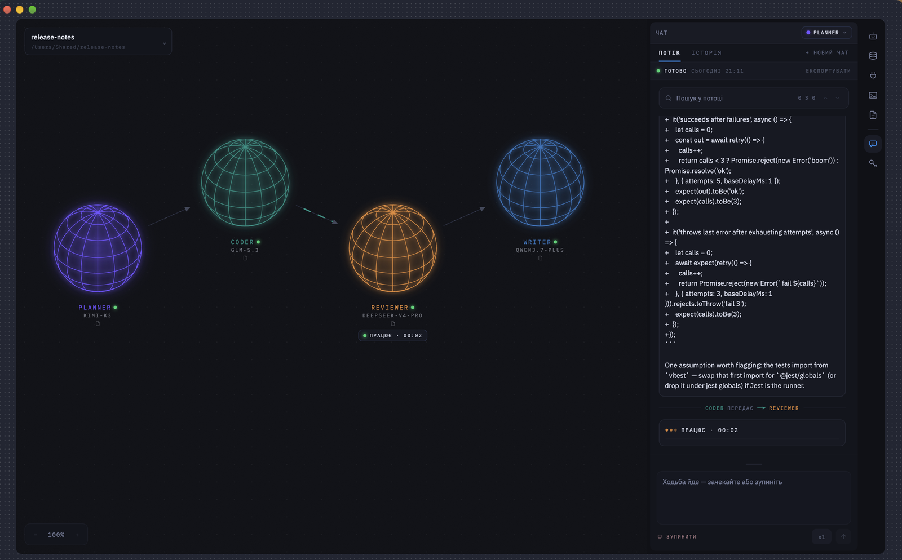
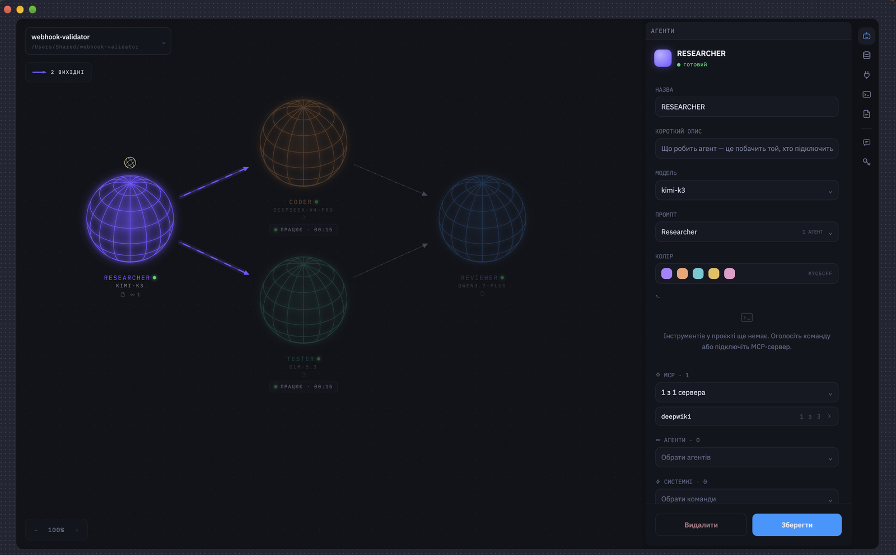
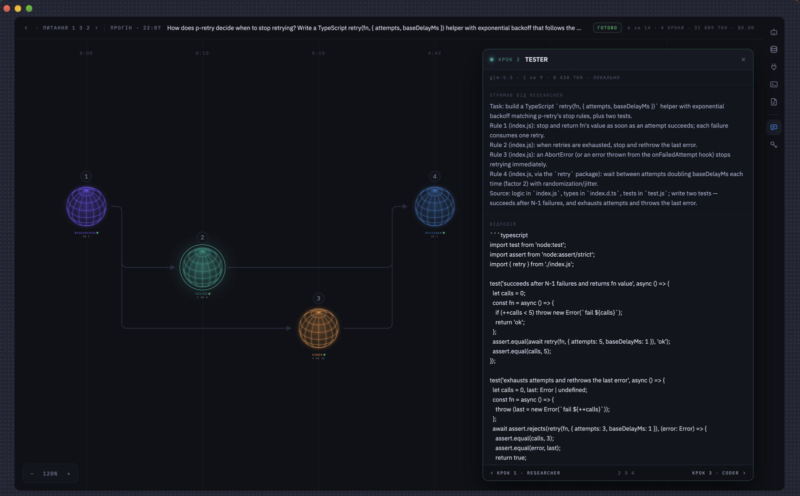

# Coder

  

An AI platform for automated code development, built around agents. The user places agents on a
canvas, connects them with directed links, and runs work through the graph — assigning models of
different cost and capability to each one, and granting each the tools it may call.

## What it does

- Agents stand on a canvas and hand work along directed links; a link that would close a ring is
  refused.
- Each agent has its own model, from Anthropic, OpenAI, Google, OpenRouter, OpenCode Go, RunPod
  (queue or OpenAI-compatible), Ollama or LM Studio.
- Each agent calls only the tools granted to it: functions of MCP servers, local or remote, the
  project's declared commands, system commands and other agents. A local server's run line starts
  only once this machine has agreed to it, word for word, so opening somebody else's project runs
  nothing it wrote.
- A question can be spoken: the microphone under the field records it, OpenAI, OpenRouter or RunPod OpenAI turns
  it into words, and they land in the field to be sent by hand. An answer is read aloud in one of the
  OS's own voices.
- `npm run agent -- <project> <agent> "question"` runs one agent's walk without the window and exits
  0 when it stood whole, 1 when something fell, 2 when the question did not go.
- A project is a folder on disk with its `project.yaml`, so an automation is committed and shared
  like any other code.
- Provider keys and server secrets are kept in a file encrypted with a key the OS keychain holds.

## Screenshot

**Built with** Electron, TypeScript, React, Vite, TypeORM + SQLite (better-sqlite3), LangChain and the
MCP TypeScript SDK.

## How it is laid out

- `src/app` — the Electron application: `main.ts` (the window), `agent-main.ts` (the same backend
  without a window, for `npm run agent`), `backend/` that builds the modules once for both, `ipc/`
  for the channels the two sides speak over, and `renderer/` for the window itself — a thin client
  that shows what the backend pushes.
- `src/modules` — what runs outside the window, one directory per responsibility: `projects` (the
  folder on disk and the registry of the ones opened), `providers` and `secrets` (the keys, in a file encrypted with a
  key the OS keychain holds), `speech` (a recording turned into words by the project's recognition model, and this
  machine's voice), `mcp` (the servers and what they hand over), `commands` (a declared line and what
  it printed), `attachments` (the files sent with a question), `llm` (one turn of an agent, and the only
  place LangChain is imported), `walks` (a conversation's walk along the canvas lines, from the
  question to the last answer) and `runs` (the record of every run). The registry and the record live in SQLite through TypeORM;
  `migrations` holds that schema.
- `src/contracts` — what both halves share: every channel's name, the shape of what travels
  through it, and the pure rules both apply. Neither side reaches into the other for a type.
- `src/utils` — what belongs to neither.
- `tests` — the end-to-end suite, run by `test:back`; every other test stands beside the file it is
  about.
- `scripts` — what `package.json` calls: the dev run, the native rebuild, the migration CLI, the
  feature graph.
- `.github/workflows/ci.yml` — CI: the three checks and both suites on Node 22 and 24.
- `design` — the agreed design, frame by frame.

## Documents and design

- `OPERATOR.md` — for whoever composes a pipeline: the project file, every field, the system
  commands, the providers, the limits and the usual troubles (in Ukrainian).
- `DESIGN.md` — how the interface looks and behaves, in words over the frames.
- `BACKEND.md` and `FRONTEND.md` — how the code is built: modules, contracts, the renderer.
- `CLAUDE.md` — how work is done in this repository: conventions, checks, commits.
- `TODO.md` — what the built product is still missing.
- `design/` — the two canvases of frames. Open `Полотно пайплайну - офлайн.html` and
  `Полотно пайплайну 2 - офлайн.html` in a browser: each carries everything inside and needs neither
  a server nor the network. `Карта кадрів.md` indexes every frame; `plain/` holds the same canvases
  as readable HTML for search and diff.

## Running it

Node.js `^22.22.2`, `^24.15.0` or `^26.0.0`, with the npm it ships — the range `engines` in
`package.json` holds, the narrowest the dependencies allow (jsdom, TypeORM, ESLint, Vite). Node runs
the tooling: the install, Vite, the checks and `test:front`; the app itself, `test:back` and the
migrations run on the Node that Electron carries.

`npm install`, then `npm run rebuild:electron` once after every install: the install builds
`better-sqlite3` for the Node that ran it, and Electron loads only one built for itself, so this
fetches Electron's headers and compiles it again. Then `npm run dev:app` — the Electron shell with
the renderer served by Vite; `npm run dev:app:watch` restarts it when the main process changes.
`npm run typecheck` covers all three tsconfigs, and `npm run test:back` and `npm run test:front` are
the two suites.

`npm run agent -- <project> <agent> "question"` asks one agent of a project without the window: the
project by its name among the recent ones or by its folder, the agent by name or id. The walk goes
along the lines to its end and prints the conversation; the exit code is 0 when it stood whole, 1
when something fell, 2 when the question did not go.

CI runs, on every push to `main` and every pull request, `typecheck`, `lint`, `prettier`,
`test:front`, then `rebuild:electron` and `test:back` — `lint` is ESLint followed by
`graph:features`, which draws which subject of the renderer imports which and fails on a ring;
`npm run format` writes what `prettier` checks. A schema change goes through
`npm run migration:generate -- src/modules/migrations/<Name>`, with `migration:run` and
`migration:revert` beside it.

## A local provider to check against

`docker compose up -d` starts Ollama at `http://localhost:11434` — the address the app's provider
card already carries. `docker-compose.yml` says which model to pull and why that one.

## Licence

Copyright © 2026 [Mykhailo Biloshkurskyi](https://www.linkedin.com/in/mykhailo-biloshkurskyi/).
Licensed under the [Apache License, Version 2.0](https://www.apache.org/licenses/LICENSE-2.0) — see `LICENSE`
and `NOTICE`. The design carries IBM Plex under the SIL Open Font License 1.1
(`design/plain/fonts/OFL.txt`) and React under the MIT License (`design/LICENSE-react.txt`).
